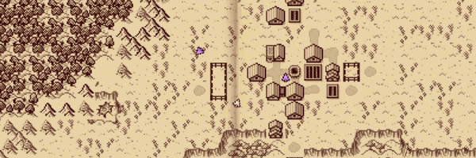

# Antique Atlas Multiplayer

An addon for [Antique Atlas](https://github.com/sleepingdragoninn/antique-atlas) (Fabric, Minecraft 1.21.1) that shows **every player on the server** on your atlas map, both on the atlas screen and on the handheld atlas.



On its own, Antique Atlas only draws players who share their map with you through Surveyor (`/surveyor share`). This mod adds everyone else.

More screenshots and details: [docs/README.md](docs/README.md).

## How it works

- **Server** (dedicated, or the host of a LAN world): every `updateIntervalTicks`, it sends each client that has the mod the position, dimension and facing of every other online player.
- **Client**: a mixin on `AntiqueAtlas.getOrderedFriends()` adds those players to the list Antique Atlas already draws (player icon, name tooltip on hover, etc.). When a player is loaded nearby, the real entity is used so the icon moves smoothly.
- **Server without the mod**: the client falls back to the players it has loaded (within your render distance).

As in Antique Atlas, only players in the dimension you're viewing are shown.

## Installation

| Side   | Required mods |
|--------|---------------|
| Client | Fabric API, Antique Atlas (+ Surveyor), **Antique Atlas Multiplayer** |
| Server | Fabric API, **Antique Atlas Multiplayer** (Antique Atlas is not needed) |

To see players at any distance, the mod must be installed on both the server and the clients.

## Configuration (server)

`config/antique_atlas_multiplayer.properties`, created on first launch:

| Key | Default | Description |
|-----|---------|-------------|
| `updateIntervalTicks` | `10` | How often positions are sent, in ticks (20 = 1 s). |
| `showSpectators` | `false` | Show players in spectator mode. |
| `showInvisible` | `false` | Show players with the invisibility effect. |
| `showSneaking` | `true` | Show players who are sneaking. |

## Building

Requires JDK 21.

```sh
./gradlew build
```

The jar ends up in `build/libs/`. To test in development: `./gradlew runClient` / `./gradlew runServer`.

## License

LGPL-3.0-or-later, same as Antique Atlas.
